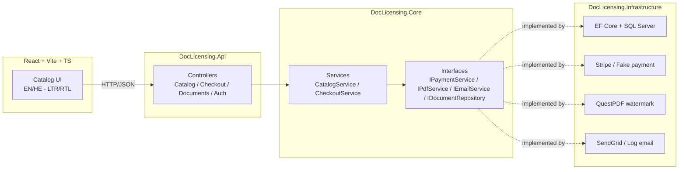

# DocLicensing

A small, production-shaped **document-licensing** application: browse a bilingual (Hebrew/English)
catalog of standards documents, license one through a card payment, and receive a **watermarked,
single-licence PDF** plus an email receipt.

It's a generic, publishable analog of the kind of public-sector e-commerce work I do day-to-day —
catalog → search → payment → document delivery — built to show how I structure a real .NET + React
codebase rather than to be a finished product.

**Stack:** ASP.NET Core Web API (.NET 8) · Entity Framework Core · SQL Server · React + TypeScript
(Vite) · react-i18next with full RTL support · xUnit · Docker · GitHub Actions.

---

## Architecture

A layered backend behind a thin API, with the integration points (payment, PDF, email) hidden
behind interfaces so they can be swapped or faked.



### Checkout flow — request lifecycle

A typical purchase goes through four endpoints. The watermarked PDF is generated on download
(not on checkout), so a re-download always carries the latest buyer name and "issued" date.

```mermaid
sequenceDiagram
    autonumber
    actor User as Browser
    participant SPA as React SPA
    participant Auth as POST /api/auth/token
    participant Cat as GET /api/catalog/search
    participant Co as POST /api/checkout
    participant CS as CheckoutService
    participant Repo as IDocumentRepository (EF Core)
    participant Pay as IPaymentService
    participant Mail as IEmailService
    participant Doc as GET /api/documents/{id}/download
    participant PDF as IPdfService (QuestPDF)

    User->>SPA: Sign in (username)
    SPA->>Auth: { username }
    Auth-->>SPA: { access_token }
    SPA->>Cat: ?q=&page=&lang=
    Cat-->>SPA: PagedResult&lt;DocumentDto&gt;
    User->>SPA: Click "License"
    SPA->>Co: Bearer token + { documentId, name, email }
    Co->>CS: CheckoutAsync
    CS->>Repo: GetByIdAsync
    CS->>Pay: ChargeAsync
    Pay-->>CS: PaymentResult
    CS->>Repo: AddPurchaseAsync
    CS->>Mail: SendReceiptAsync
    CS-->>Co: CheckoutResult (downloadUrl)
    Co-->>SPA: CheckoutResult
    SPA->>Doc: GET /api/documents/{id}/download?purchase=…
    Doc->>Repo: GetPurchaseAsync + GetByIdAsync
    Doc->>PDF: GenerateLicensedPdf(doc, buyerName)
    PDF-->>Doc: bytes
    Doc-->>User: application/pdf (watermarked)
```

**Projects**

| Project | Responsibility |
|---|---|
| `DocLicensing.Core` | Domain models, DTOs, service interfaces, business logic. No framework dependencies. |
| `DocLicensing.Infrastructure` | EF Core `DbContext` + repository, and the payment/PDF/email implementations. |
| `DocLicensing.Api` | Controllers, DI wiring, Swagger, JWT auth, CORS. |
| `DocLicensing.Tests` | xUnit tests for the checkout flow using in-memory fakes. |
| `src/web` | React + TypeScript frontend with i18n and RTL. |

---

## Screenshots

| | |
|---|---|
| **Catalog (English)** — paged catalog with the debounced search bar |  |
| **Catalog (עברית)** — the same page, language toggle flips the whole layout to RTL |  |
| **Checkout success** — JWT-gated checkout returns a watermarked-PDF download link |  |
| **Swagger** — the API surface (Catalog / Checkout / Documents / Auth) |  |

_See `screenshots/README.md` for the capture checklist used to produce these._

---

## Running it

### Backend (API)

Requires the .NET 8 SDK (or newer) and either SQL Server LocalDB (default) or the Docker setup below.

```bash
dotnet restore
dotnet run --project src/DocLicensing.Api
```

Then open **http://localhost:5080/swagger**. In Development the database is created from the EF
migrations and seeded on startup, so the catalog works immediately.

Try the flow in Swagger:

1. `GET /api/catalog?lang=he` — bilingual catalog.
2. `GET /api/catalog/search?q=security&lang=he&page=1&pageSize=5` — paged search across code,
   titles (EN+HE), descriptions and category.
3. `POST /api/auth/token` with `{ "username": "sofia" }` — copy the `access_token`, click
   **Authorize** in Swagger, paste `Bearer <token>`.
4. `POST /api/checkout` with `{ "documentId": 1, "buyerName": "Sofia", "buyerEmail": "s@example.com" }`.
5. Open the returned `downloadUrl` — `GET /api/documents/1/download?purchase=…` — to get the
   watermarked PDF.

### Migrations

EF Core migrations are checked in under `src/DocLicensing.Infrastructure/Migrations/`. `dotnet-ef`
is a local tool — restore it once with `dotnet tool restore`, then add new migrations with:

```bash
dotnet ef migrations add <Name> \
  --project src/DocLicensing.Infrastructure \
  --startup-project src/DocLicensing.Api
```

The dev startup applies pending migrations automatically.

### Frontend (React)

Requires Node 20+.

```bash
cd src/web
npm install
npm run dev
```

Open **http://localhost:5173**. The catalog loads from the API; the language switcher toggles
EN ↔ HE and flips the whole layout LTR ↔ RTL. (Set `VITE_API_URL` via `.env` if the API isn't on
`localhost:5080` — see `.env.example`.)

### Everything via Docker

```bash
docker compose up --build
```

Brings up SQL Server + the API (seeded) on http://localhost:5080.

### Tests

```bash
dotnet test
```

---

## Design decisions

These are the choices I'd defend in a review — no metrics I can't measure, just the reasoning.

- **Layered with interface seams (Core / Infrastructure / Api).** `Core` holds the business logic
  and depends on nothing. The payment, PDF, and email providers sit behind interfaces, so the API
  doesn't know whether payments go to Stripe or a fake. This is what makes `CheckoutService`
  testable without a database or a real payment provider.
- **Provider strategy via configuration.** `Payments:Provider` / `Email:Provider` select the real
  vs. fake implementation in `AddInfrastructure`. The defaults (`Fake`, `Log`) let the project run
  end-to-end with zero secrets; flip them once Stripe/SendGrid keys are in user-secrets.
- **Localisation in the data model, not duplicated rows.** A `Document` carries both `TitleEn` and
  `TitleHe`; `CatalogService` projects to a single localised `DocumentDto` based on the requested
  language. The frontend mirrors this with one resource bundle per language and an RTL flip driven
  by the document `dir` attribute, applied from `LanguageSwitcher` on every language change.
- **EF Core migrations as the source of truth.** `Database.Migrate()` runs on dev startup, so a
  fresh checkout boots a schema + seed in one step. `dotnet-ef` is registered as a local tool
  (`.config/dotnet-tools.json`) so `dotnet tool restore` is enough to add new migrations.
- **Search via `EF.Functions.Like` across five fields** (`Code`, `TitleEn`, `TitleHe`,
  `DescriptionEn`, `DescriptionHe`). A single SQL query gives bilingual relevance without an
  extra index store; Examine/Lucene is the obvious upgrade when this gets too slow.
- **Auth as a React Context, not props drilling.** `AuthProvider` (`src/web/src/auth.tsx`) holds
  the JWT in `localStorage` so a refresh keeps you signed in; `useAuth()` reads it from any page
  or component. The checkout call attaches the token from one place (`api.ts`).
- **Pages own data, components stay dumb.** Each route under `src/web/src/pages/` does the
  fetching and URL-state handling; the components under `src/web/src/components/` (`CatalogCard`,
  `SearchBar`, `CheckoutDialog`) take props and emit events. Makes the components trivial to
  test in isolation.
- **Debounce in `SearchBar` owns a local draft.** The input is responsive to keystrokes
  (immediate `draft` state) but only fires `onChange` after the user stops typing for
  `debounceMs`. Search URLs in the address bar update at most once per pause, so refreshes
  and shares give the right result.

---

## One-week build roadmap

This repository is the **starting skeleton**. The plan to take it to "portfolio-ready":

- [x] **Day 1** — Solution skeleton: layered API, EF Core + seed, catalog endpoint, React catalog
      with EN/HE + RTL, Swagger, tests, Docker, CI.
- [x] **Day 2** — EF Core migrations replace `EnsureCreated`; `GET /api/catalog/search` with
      `q` / `category` filtering and paging via `EF.Functions.Like` across code, titles (EN+HE)
      and descriptions; catalog expanded to 12 bilingual documents across 12 categories;
      `dotnet-ef` registered as a local tool; search tests added.
- [x] **Day 5** — Frontend: routes via `react-router-dom`, JWT-backed `AuthProvider` + demo
      login flow, debounced `SearchBar` driving `GET /api/catalog/search` with paging, modal
      `CheckoutDialog` with form validation and success state, "My Purchases" page backed by
      `localStorage`, and Vitest + Testing Library tests for the RTL flip, search debounce, and
      checkout sign-in gating.
- [ ] **Day 3** — Implement `StripePaymentService` (test mode) and `SendGridEmailService` for real;
      handle the Stripe webhook to confirm payment.
- [ ] **Day 4** — Replace demo JWT with ASP.NET Core Identity (or Azure AD); a real "my purchases"
      page behind auth.
- [ ] **Day 6** _(deferred)_ — Deploy to Azure. First attempt was blocked by network restrictions
      (corporate DNS, Safe Browsing on the unique-hostname URL, no log visibility). Will retry from
      an unrestricted network with the same target architecture (App Service + Azure SQL + Static
      Web Apps).
- [x] **Day 7** — README polish: checkout-flow sequence diagram, screenshots section, expanded
      design-decisions (frontend architecture, debounce, auth context); `CheckoutDialog` Escape +
      autofocus + `aria-labelledby`; `LanguageSwitcher` syncs `<html dir|lang>` on mount; dropped
      two incorrect `[dir="rtl"]` CSS overrides so `text-align: start` and `justify-content:
      flex-end` follow the writing direction natively.

---

## Notes

- **No secrets are committed.** Stripe/SendGrid keys are read from configuration / user-secrets /
  environment variables. The JWT signing key in `appsettings.json` is a development placeholder —
  replace it for any real deployment.
- The `Stripe`/`SendGrid` classes are intentionally **stubs** marked with `TODO` — the seams are in
  place; Day 3 fills them in.
